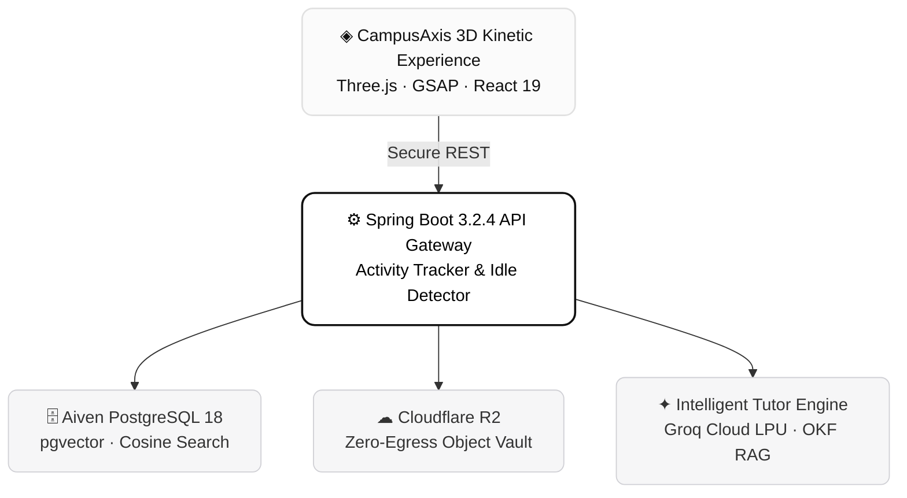

<div align="center">

<br />

# CampusAxis

**The Sovereign Academic Operating System**

A calm, high-performance workspace engineered for curriculum mastery, zero-latency note streaming, and contextual AI tutoring.

<br />

<p align="center">
  
  
  
  
</p>

<br />

---

<br />

</div>

## ✦ System Architecture

<div align="center">



</div>

<br />

---

<br />

## ✦ Crafted Capabilities

<table>
  <tr>
    <td width="33%" valign="top">
      <h4>01 · Kinetic Atmosphere</h4>
      <p>Three.js WebGL procedural ribbon simulation with custom physical sheen and real-time shadow casting.</p>
    </td>
    <td width="33%" valign="top">
      <h4>02 · OKF Knowledge Stream</h4>
      <p>Continuous conversion of unstructured academic lectures into Google Open Knowledge Format with indexed YAML frontmatter.</p>
    </td>
    <td width="33%" valign="top">
      <h4>03 · Zero-Egress Storage</h4>
      <p>High-throughput S3 streaming through Cloudflare R2, eliminating network egress fees completely.</p>
    </td>
  </tr>
  <tr>
    <td width="33%" valign="top">
      <h4>04 · Subject-Aware Tutor</h4>
      <p>Unit-wise vector RAG leveraging Groq LPUs for sub-second syllabus queries and exam preparation.</p>
    </td>
    <td width="33%" valign="top">
      <h4>05 · Sovereign Archive</h4>
      <p>Curriculum roadmaps, semester PYQs, and an in-browser zero-lag document previewer.</p>
    </td>
    <td width="33%" valign="top">
      <h4>06 · Attendance Ledger</h4>
      <p>Predictive attendance tracker calculating safe-cut margins and scheduled academic alerts.</p>
    </td>
  </tr>
</table>

<br />

---

<br />

## ✦ Tech Stack Matrix

| Layer | Technologies |
| :--- | :--- |
| **Interface** | React 19 · Vite 6 · Tailwind CSS · React Router v7 |
| **Visuals & 3D** | Three.js · GSAP 3 · ScrollTrigger · Framer Motion |
| **Server** | Java 21 · Spring Boot 3.2.4 · Spring Data JPA |
| **Data & Vectors** | Managed PostgreSQL 18 · pgvector · HikariCP |
| **Object Storage** | Cloudflare R2 (S3-compatible API) |
| **Inference** | Groq Cloud API · Gemini Web2API · Embeddings |

<br />

---

<br />

## ✦ Quickstart

```bash
# 1. Clone repository
git clone https://github.com/199adarsh/CampusAxis.git
cd CampusAxis

# 2. Boot Backend (Port 8080)
cd backend
mvn clean install -DskipTests
mvn spring-boot:run

# 3. Boot Frontend (Port 5173)
cd ../frontend
npm install
npm run dev
```

<br />

---

<br />

## ✦ Environment Specification

```env
# Database
DB_JDBC_URL=jdbc:postgresql://host:port/dbname?sslmode=require
DB_USER=postgres
DB_PASSWORD=your_secure_password
DB_DRIVER=org.postgresql.Driver
DDL_AUTO=update

# Cloudflare R2 Storage
R2_ACCESS_KEY_ID=your_r2_access_key
R2_SECRET_ACCESS_KEY=your_r2_secret_key
R2_ENDPOINT=https://<account_id>.r2.cloudflarestorage.com
R2_BUCKET_NAME=campusaxis-notes

# AI Inference
GROQ_API_KEY=gsk_your_groq_api_key
GEMINI_BASE_URL=http://localhost:8000
```

<br />

---

<br />

<div align="center">

<sub>Designed & crafted with precision for academic excellence. MIT License.</sub>

</div>
